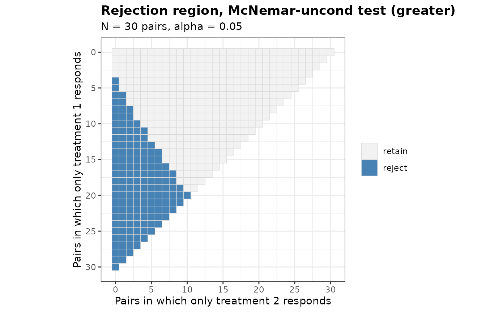
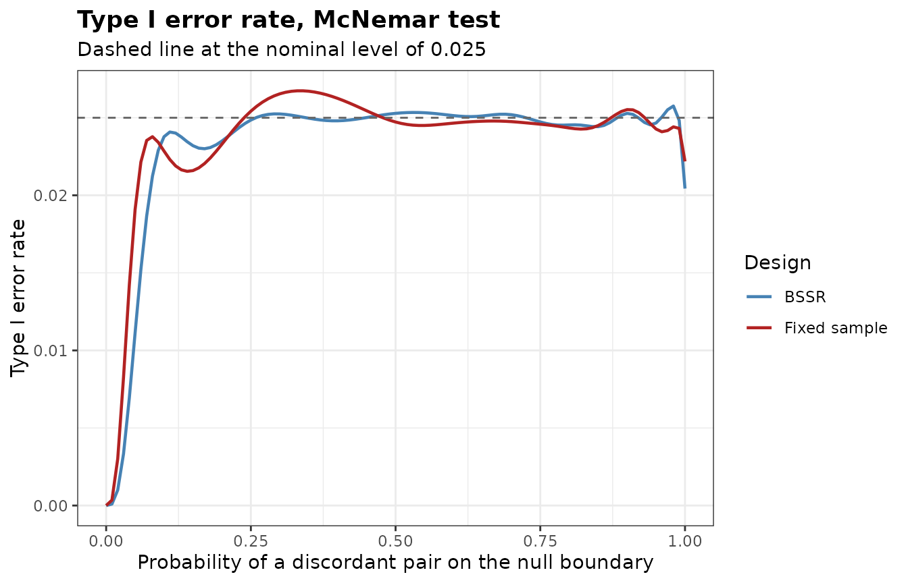

# Paired Binary Data

``` r

library(bbssr)
```

## Design and notation

In a matched-pairs design both treatments are applied to the same unit,
as in a cross-over trial, a comparison of two diagnostic procedures on
the same patients, or a trial that treats one eye of each patient with
each treatment. A pair has one of four outcomes. Let $`p_{10}`$ be the
probability that only treatment 1 responds and $`p_{01}`$ the
probability that only treatment 2 responds. The difference of the
response probabilities of the two treatments is
$`\delta = p_{10} - p_{01}`$, and the probability of a discordant pair
is $`\psi = p_{10} + p_{01}`$. Among $`N`$ pairs, let $`a`$ and $`b`$ be
the numbers of the two kinds of discordant pairs. All tests of the
package depend on the data only through $`(a, b)`$.

The `Paired*` functions follow the `Binary*` functions for two
independent groups:
[`PairedRR()`](https://gosukehommaex.github.io/bbssr/reference/PairedRR.md),
[`PairedPower()`](https://gosukehommaex.github.io/bbssr/reference/PairedPower.md)
and
[`PairedSampleSize()`](https://gosukehommaex.github.io/bbssr/reference/PairedSampleSize.md)
for the fixed design, and
[`PairedPowerBSSR()`](https://gosukehommaex.github.io/bbssr/reference/PairedPowerBSSR.md),
[`PairedBSSR()`](https://gosukehommaex.github.io/bbssr/reference/PairedBSSR.md),
[`PairedTypeIErrorBSSR()`](https://gosukehommaex.github.io/bbssr/reference/PairedTypeIErrorBSSR.md)
and
[`PairedAlphaAdjBSSR()`](https://gosukehommaex.github.io/bbssr/reference/PairedAlphaAdjBSSR.md)
for blinded sample size re-estimation.

## Tests

Six tests are available. `'McNemar'` refers
$`Z = (a - b) / \sqrt{a + b}`$ to the standard normal distribution, and
`'McNemar-cc'` refers $`(|a - b| - 1) / \sqrt{a + b}`$ to it, with the
continuity correction of formula (2) of Fagerland et al. (2013), and
$`(a - b - 1) / \sqrt{a + b}`$ for a one-sided alternative.
`'McNemar-exact'` refers $`a`$ to the binomial distribution with
$`a + b`$ trials and probability 1/2, and `'McNemar-midP'` is its mid-p
version (Fagerland et al., 2013). `'McNemar-uncond'` orders the outcomes
by $`Z`$ and maximizes the null tail probability over $`\psi`$ (Suissa
and Shuster, 1991; Berger and Sidik, 2003), optionally with the
Berger-Boos procedure. `'Paired-Score'` is the score test of Nam (1997)
and Tango (1998) for the null hypothesis $`\delta = -\text{margin}`$,
which reduces to `'McNemar'` with a margin of 0.

The example of Berger and Sidik (2003, Section 4) has $`n = 30`$ pairs
with $`x_{10} = 11`$ and $`x_{01} = 4`$ and tests $`p_{10} \le p_{01}`$
against $`p_{10} > p_{01}`$.

``` r

pv <- function(...) attr(PairedRR(N = 30, alpha = 0.05, ...), 'p.value')[12, 5]
p.bs <- c(exact = pv(Test = 'McNemar-exact'),
          asymptotic = pv(Test = 'McNemar'),
          unconditional = pv(Test = 'McNemar-uncond', ref.pvalue = TRUE),
          berger.boos = pv(Test = 'McNemar-uncond', ref.pvalue = TRUE, bb.gamma = 0.0005))
round(p.bs, 4)
#>         exact    asymptotic unconditional   berger.boos 
#>        0.0592        0.0354        0.0494        0.0382
```

The p-values 0.0592, 0.0354, 0.0494, 0.0382 are those of the tests CB,
M, Z and $`Z_C`$ in Table 3 of Berger and Sidik (2003). The rejection
region of a test is a triangle of possible outcomes.

``` r

plot(PairedRR(N = 30, alpha = 0.05, Test = 'McNemar-uncond', ref.pvalue = TRUE))
```



## Power and number of pairs

The power is the probability of the rejection region under the
multinomial distribution of $`(a, b, N - a - b)`$, computed by
enumeration. The normal approximation to the number of pairs is formula
(9) of Nam (1997), which is formula (3) of Connor (1987) when the margin
is 0. In the example of Connor (1987, p. 210) the response probabilities
are 0.8 and 0.7 and $`\psi = 0.3`$, so $`p_{10} = 0.2`$ and
$`p_{01} = 0.1`$.

``` r

n.std <- PairedSampleSize(p10 = 0.2, p01 = 0.1, alpha = 0.05, tar.power = 0.9,
                          Test = 'McNemar', method = 'standard')
n.exact <- PairedSampleSize(p10 = 0.2, p01 = 0.1, alpha = 0.05, tar.power = 0.9,
                            Test = 'McNemar-exact')
n.midp <- PairedSampleSize(p10 = 0.2, p01 = 0.1, alpha = 0.05, tar.power = 0.9,
                           Test = 'McNemar-midP')
c(standard = n.std$N, exact = n.exact$N, midp = n.midp$N)
#> standard    exact     midp 
#>      254      269      252
```

The normal approximation gives 254 pairs, as in Connor (1987). The exact
search needs 269 pairs for the exact conditional test and 252 for its
mid-p version.

## Blinded sample size re-estimation

The number of discordant pairs can be counted without unblinding: a pair
is discordant whatever treatment responded. At an interim analysis after
$`n_{1}`$ pairs, the blinded estimate of $`\psi`$ is $`D_{1} / n_{1}`$,
where $`D_{1}`$ is the number of discordant pairs. The assumed
difference `Delta.A` is kept, and the estimate is raised to
$`|\Delta_{A}|`$ when it is smaller. The number of pairs is then
re-estimated by the normal approximation (`ss.method = 'standard'`), by
the exact search (`'exact'`), or by the smallest number at which the
conditional power given $`D_{1}`$ reaches the target
(`'conditional.power'`), the rule of Schepers et al. (2026). The
re-estimation depends on the data only through $`D_{1}`$, and given the
numbers of discordant pairs the direction of each discordant pair is
independent of them, so the power is computed exactly.

Schepers et al. (2026) plan the exact conditional test at the two-sided
level 0.05 with $`\Delta_{A} = 0.15`$ and $`\psi = 0.2`$.

``` r

plan <- PairedSampleSize(p10 = 0.175, p01 = 0.025, alpha = 0.05, tar.power = 0.8,
                         Test = 'McNemar-exact', alternative = 'two.sided',
                         search = 'smallest')
plan$N
#> [1] 72
```

``` r

res <- PairedPowerBSSR(psi = c(0.15, 0.2, 0.3), Delta.T = 0.15, Delta.A = 0.15,
                       N = plan$N, n.interim = 30, alpha = 0.05, tar.power = 0.8,
                       Test = 'McNemar-exact', alternative = 'two.sided',
                       ss.method = 'conditional.power', N.max = 200)
res
#> Blinded sample size re-estimation for paired binary data
#> 
#>   Test             : McNemar-exact
#>   Alternative      : two.sided
#>   Re-estimation    : conditional power (unrestricted)
#>   Pairs            : N = 72 planned, 30 at the interim analysis
#>   Effect           : assumed 0.15, true 0.15
#>   Alpha            : 0.05, target power 0.8
#> 
#>   psi   p10   p01 power.BSSR power.TRAD    E.N
#>  0.15 0.150 0.000     0.8946     0.9684  63.98
#>  0.20 0.175 0.025     0.7415     0.8056  74.97
#>  0.30 0.225 0.075     0.7443     0.5824 109.72
```

With $`\psi = 0.3`$ the fixed design of 72 pairs has power 0.582, and
the re-estimation design 0.744 with 109.7 pairs on average. With
$`\psi = 0.15`$ the fixed design has power 0.968 and the re-estimation
design 0.895.

[`PairedBSSR()`](https://gosukehommaex.github.io/bbssr/reference/PairedBSSR.md)
performs the re-estimation of a single trial. With 5 discordant pairs
among 30 interim pairs:

``` r

PairedBSSR(n1 = 30, D1 = 5, Delta.A = 0.15, alpha = 0.05, tar.power = 0.8,
           Test = 'McNemar-exact', alternative = 'two.sided',
           ss.method = 'conditional.power', N.max = 200)
#> Blinded sample size re-estimation from paired interim data
#> 
#>   Test             : McNemar-exact
#>   Alternative      : two.sided
#>   Re-estimation    : conditional power (unrestricted)
#>   Assumed effect   : 0.15
#>   Alpha            : 0.05, target power 0.8
#> 
#> Interim data
#>   Pairs            : n1 = 30, discordant D1 = 5
#>   Discordance      : estimate 0.1667, used 0.1667
#>   Planning values  : p10 = 0.1583, p01 = 0.0083
#> 
#> Re-estimation
#>   Re-estimated N   : 53
#>   Still to enrol   : 23 pairs
#>   Final N          : 53
#>   Power at final N : 0.7499
#>   Conditional power: 0.8077
```

## Type I error rate

The exact conditional test keeps its level after any blinded
re-estimation, since the number of pairs in which only treatment 1
responds stays binomial given the total number of discordant pairs
(Schepers et al., 2026). The other tests have a type I error rate that
depends on $`\psi`$, and the re-estimation can change it.
[`PairedTypeIErrorBSSR()`](https://gosukehommaex.github.io/bbssr/reference/PairedTypeIErrorBSSR.md)
computes the rate on the boundary $`p_{10} = p_{01}`$ and certifies its
largest value. In the example the final number of pairs is at most 150.

``` r

tie <- PairedTypeIErrorBSSR(Delta.A = 0.15, N = plan$N, n.interim = 30, alpha = 0.025,
                            tar.power = 0.8, Test = 'McNemar', ss.method = 'standard',
                            N.max = 150)
attr(tie, 'max')
#>   Design       psi        TIE      bound
#> 1   BSSR 0.9790955 0.02576064 0.02576064
#> 2   TRAD 0.3351974 0.02673970 0.02673970
plot(tie)
```



The largest type I error rate of the asymptotic McNemar test at the
one-sided level 0.025 is 0.0258 for the re-estimation design and 0.0267
for the fixed design.
[`PairedAlphaAdjBSSR()`](https://gosukehommaex.github.io/bbssr/reference/PairedAlphaAdjBSSR.md)
lowers the nominal level until the rate is controlled.

``` r

adj <- PairedAlphaAdjBSSR(Delta.A = 0.15, N = plan$N, n.interim = 30, alpha = 0.025,
                          tar.power = 0.8, Test = 'McNemar', ss.method = 'standard',
                          N.max = 150)
adj
#> Adjusted significance level for blinded sample size re-estimation
#> 
#>   Test            : McNemar
#>   Alternative     : greater
#>   Adjusted part   : final analysis only
#>   Maximum         : certified over psi in [0, 1]
#>   Target level    : 0.025
#> 
#>        Design   max.TIE alpha.adj max.TIE.adj
#>          BSSR 0.0257606 0.0242598   0.0246174
#>  Fixed sample 0.0267397 0.0244499   0.0247896
```

## Non-inferiority and equivalence

The score test takes a margin. With `alternative = 'greater'` and
`margin = 0.05` it tests $`\delta \le -0.05`$ against
$`\delta > -0.05`$. Nam (1997, Section 5) plans a trial with
$`p_{01} = 0.05`$, $`\delta_{0} = -0.05`$ and $`\delta_{1} = 0`$ at the
one-sided level 0.05 with power 0.8.

``` r

ni <- PairedSampleSize(p10 = 0.05, p01 = 0.05, alpha = 0.05, tar.power = 0.8,
                       Test = 'Paired-Score', margin = 0.05)
c(normal = attr(ni, 'n.raw'), exact = ni$N)
#>   normal    exact 
#> 273.8196 269.0000
```

Formula (9) of Nam (1997) gives 273.8 pairs, and the exact power of the
score test reaches 0.8 with 269 pairs. With
`alternative = 'equivalence'` and `margin = c(lower, upper)` the null
hypothesis $`\delta \le -\text{lower}`$ or $`\delta \ge \text{upper}`$
is tested by two one-sided score tests. In a re-estimation design the
type I error rate is evaluated on both boundaries.

## References

Berger, R. L. and Sidik, K. (2003). Exact unconditional tests for a 2 ×
2 matched-pairs design. *Statistical Methods in Medical Research*, 12,
91-108.

Connor, R. J. (1987). Sample size for testing differences in proportions
for the paired-sample design. *Biometrics*, 43, 207-211.

Fagerland, M. W., Lydersen, S. and Laake, P. (2013). The McNemar test
for binary matched-pairs data: mid-p and asymptotic are better than
exact conditional. *BMC Medical Research Methodology*, 13, 91.

Nam, J. (1997). Establishing equivalence of two treatments and sample
size requirements in matched-pairs design. *Biometrics*, 53, 1422-1430.

Schepers, M., Brannath, W., Hoffmann, E., Stingl, J. and Schmidtmann, I.
(2026). Blinded sample size review for McNemar’s test based on primary
and surrogate endpoints. arXiv:2608.17784.

Suissa, S. and Shuster, J. J. (1991). The 2 x 2 matched-pairs trial:
exact unconditional design and analysis. *Biometrics*, 47, 361-372.

Tango, T. (1998). Equivalence test and confidence interval for the
difference in proportions for the paired-sample design. *Statistics in
Medicine*, 17, 891-908.
