# Validation by Reproducing Published Figures

## Purpose

This vignette redraws twenty figures of seven publications on binary
endpoints, blinded sample size re-estimation and exact tests from values
computed with bbssr: Figures 1 to 4 of Friede and Kieser (2004), Figures
21.1 to 21.4 and 23.1 to 23.3 of Kieser (2020), Figures 1 to 3 of
Friede, Mitchell and Mueller-Velten (2007) and Figure 2 of Boschloo
(1970) for two groups, and Figure 2 of Berger and Sidik (2003), Figures
1 and 2 of Fagerland, Lydersen and Laake (2013) and Figures 1 and 2 of
Schepers et al. (2026) for matched pairs. A figure carries the operating
characteristics of a design over a whole range of parameters, so its
agreement with the original checks the package at many more points than
the tables that `reproduce-published.R` compares (see the validation
vignette). Where the text of a publication states values that are read
from a figure, they are compared with the recomputed values.

The original figures are not reproduced here; they are to be compared
with the publications. The axis ranges, tick marks, line types and
symbols follow the original figures, so that a figure can be laid next
to its original. Each section states how the design was specified, what
the publication leaves open, and where the figure departs from the
original.

The values for two groups take about half an hour to compute. They are
computed by the script `reproduce-figures.R`, those for matched pairs by
`reproduce-figures-paired.R`, and both are stored in the folder
`extdata/published-figures` of the package. The figures are drawn by the
functions in `plot-figures.R`; the three scripts are installed in the
folder given by `system.file('reproduce', package = 'bbssr')`. The last
section recomputes some of the stored values with the installed version
of the package.

## Friede and Kieser (2004)

All four figures use the two-sided chi-squared test at level 0.05 and
the target power 0.8. The sample size comes from formula (1) of the
article, which uses the variance under the null hypothesis, with each
group rounded up, and the recalculation is unrestricted with an upper
bound of twice the required total sample size $`n`$. For a figure drawn
against $`n`$, the assumed difference $`\Delta^*`$ is the one for which
formula (1) gives $`n`$ at the overall rate $`\pi`$, so that the
recalculated total is $`n \hat{\pi}(1 - \hat{\pi}) / \{\pi (1 - \pi)\}`$
as in formula (2) of the article.

### Figure 1 (p. 272)

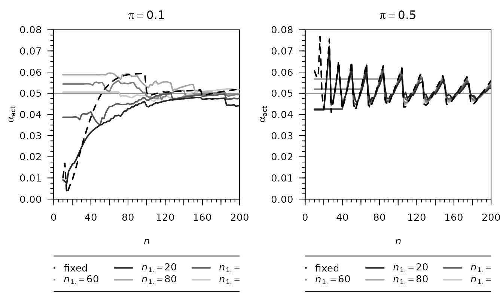

Actual type I error rate against the observed total sample size $`n`$
(fixed design, dashed) or the required total sample size $`n`$ (internal
pilot study design with $`n_{1\cdot}`$ patients in the pilot, solid),
for the overall rates 0.1 and 0.5 and equal groups. The figure agrees
with the original, including the step of the fixed design near
$`n = 100`$ for $`\pi = 0.1`$ and the saw-tooth pattern for
$`\pi = 0.5`$.

### Figure 2 (p. 273)


Minimum, mean and maximum of the actual type I error rate against the
pilot size $`n_{1\cdot}`$, over the overall rates 0.05, 0.1, 0.2, …, 0.5
and the required totals 30, 40, …, 300 (168 combinations) for the
internal pilot study design, and over the same rates and the observed
totals of at least $`n_{1\cdot}`$ for the fixed design. The caption of
the article draws the internal pilot study design dashed and the fixed
design solid, but the figure itself draws them the other way round: the
dashed minimum of about 0.005 at $`n_{1\cdot} = 20`$ occurs only in the
fixed design, whose recomputed minimum there is 0.0051, while the
minimum of the internal pilot study design is 0.0136. The figure above
follows the original figure, with the fixed design dashed, and with this
assignment all six lines of each panel agree with the original.

The article states that the largest type I error rate is below 0.06 in
all scenarios for $`\theta = 3`$, and for $`n_{1\cdot} \ge 60`$ for
$`\theta = 1`$. The recomputed maxima are 0.0563 for $`\theta = 3`$,
0.0595 for $`\theta = 1`$ and $`n_{1\cdot} \ge 60`$, and 0.0649 for
$`\theta = 1`$ and $`n_{1\cdot} < 60`$.

### Figure 3 (p. 274)

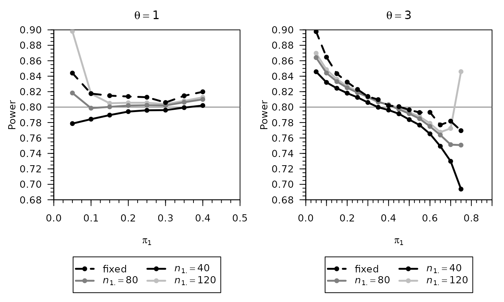

Actual power against the response rate $`\pi_1`$ for the alternative
$`\Delta^* = 0.2`$, the fixed design with the sample size of formula (1)
at the true rates (dashed) and the internal pilot study design with
$`n_{1\cdot} = 40`$, 80 and 120. The larger group receives the larger
rate $`\pi_1 + 0.2`$, the choice under which Table I of the article is
reproduced by `reproduce-published.R`; the points of the figure at the
rates of Table I are the values of that table. The figure agrees with
the original, including the rise at $`\pi_1 = 0.75`$ for $`\theta = 3`$
and $`n_{1\cdot} = 120`$.

### Figure 4 (p. 277)


Actual type I error rate in the depression trial of Section 5 of the
article: the fixed design with 122 patients per group against the
overall rate (left), and the internal pilot study design with
$`\Delta^* = 0.15`$ and a pilot of 120 patients against the required
total $`n`$ (right). Both panels agree with the original.

## Kieser (2020), Chapter 21

The figures use the normal approximation test, which is equivalent to
the chi-squared test, at the one-sided level 0.025 and the target power
0.8, with the sample size of formula (21.3) of the book and unrestricted
recalculation. Group 1 of bbssr is the experimental group E, so the
allocation ratio $`r = n_E / n_C`$ of the book is the argument r of
bbssr. Example 21.1 of the book (the BACLOREA trial) assumes the rates
$`p_{E,A} = 0.27`$ and $`p_{C,A} = 0.42`$, so the overall rate
$`p_A = 0.345`$, and gives $`n_0 = 2 \times 157`$ and a pilot of
$`79 + 79`$ patients.

### Figure 21.1 (p. 229)

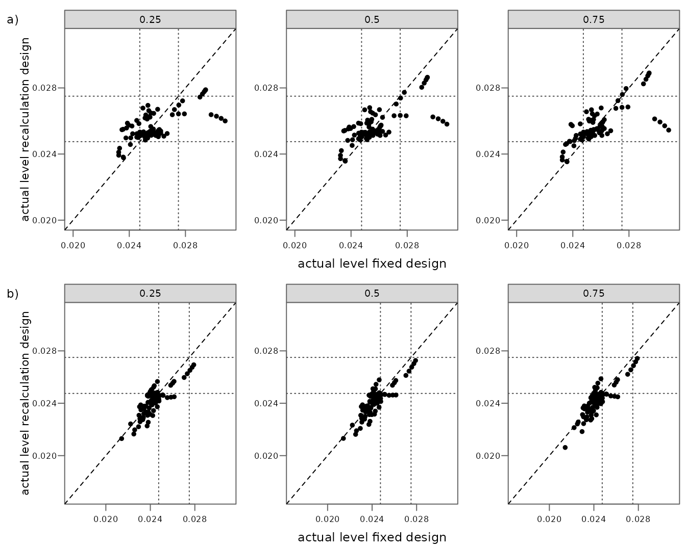

Actual level of the recalculation design against that of the fixed
design for the alternatives $`\Delta_A = 0.15`$, 0.20, 0.25 and 0.30,
the assumed overall rates $`p_A = 0.30, 0.31, \ldots, 0.50`$ and pilots
of 25, 50 and 75 per cent of the fixed sample size, for $`r = 1`$ (a)
and $`r = 3`$ (b). The book does not state three details. The levels are
evaluated here at the assumed overall rate $`p_A`$, the alternative is
$`p_E > p_C`$, and the pilot has $`\lceil f n_C \rceil`$ patients in
group C for the fraction $`f`$ and $`r`$ times as many in group E, which
gives the pilot of Example 21.1. The dotted lines are drawn where the
book draws them, at 0.02475 and 0.0275, although its caption gives
0.0225 and 0.0275.

| Design | Book | bbssr | Agrees | Stop after the pilot | Agrees |
|:---|---:|---:|:---|---:|:---|
| r = 1, fixed design: mean | 0.0257 | 0.025722 | yes |  |  |
| r = 1, fixed design: minimum | 0.0233 | 0.023247 | no |  |  |
| r = 1, fixed design: maximum | 0.0308 | 0.030828 | yes |  |  |
| r = 1, recalculation design: mean | 0.0257 | 0.025667 | yes | 0.025646 | no |
| r = 1, recalculation design: minimum | 0.0235 | 0.023533 | yes | 0.023533 | yes |
| r = 1, recalculation design: maximum | 0.0289 | 0.028904 | yes | 0.028904 | yes |
| r = 1, recalculation design, pilot 25%: mean | 0.0256 | 0.025648 | yes | 0.025583 | yes |
| r = 1, recalculation design, pilot 25%: minimum | 0.0238 | 0.023777 | yes | 0.023777 | yes |
| r = 1, recalculation design, pilot 25%: maximum | 0.0279 | 0.027889 | yes | 0.027889 | yes |
| r = 1, recalculation design, pilot 50%: mean | 0.0257 | 0.025677 | yes | 0.025678 | yes |
| r = 1, recalculation design, pilot 50%: minimum | 0.0236 | 0.023570 | yes | 0.023570 | yes |
| r = 1, recalculation design, pilot 50%: maximum | 0.0286 | 0.028644 | yes | 0.028644 | yes |
| r = 1, recalculation design, pilot 75%: mean | 0.0257 | 0.025677 | yes | 0.025677 | yes |
| r = 1, recalculation design, pilot 75%: minimum | 0.0235 | 0.023533 | yes | 0.023533 | yes |
| r = 1, recalculation design, pilot 75%: maximum | 0.0289 | 0.028904 | yes | 0.028904 | yes |
| r = 3, fixed design: mean | 0.0243 | 0.024286 | yes |  |  |
| r = 3, fixed design: minimum | 0.0214 | 0.021421 | yes |  |  |
| r = 3, fixed design: maximum | 0.0279 | 0.027905 | yes |  |  |
| r = 3, recalculation design: mean | 0.0241 | 0.024168 | no | 0.024048 | no |
| r = 3, recalculation design: minimum | 0.0174 | 0.020622 | no | 0.017395 | yes |
| r = 3, recalculation design: maximum | 0.0274 | 0.027421 | yes | 0.027421 | yes |

The table lists the mean, minimum and maximum that the book reports for
the figure, after rounding to four decimals; 18 of the 21 values agree.
For $`r = 1`$ the scatter and all values of the recalculation design
agree. The minimum of the fixed design is 0.023247, which rounds to
0.0232 rather than to the 0.0233 of the book; it lies 2.8
$`\times 10^{-6}`$ below the rounding boundary, and the reason for the
difference is not known.

For $`r = 3`$ the recalculation design departs from the book: the book
reaches the minimum 0.0174 at the smallest pilots, while bbssr gives
0.0206. The difference arises from the interim outcomes for which the
recovered rate of group C, $`\hat{p} - r \Delta_A / (1 + r)`$, is
negative. The book does not say how such outcomes are treated. bbssr
truncates the Bernoulli variance of that group at zero and re-estimates
the sample size from the remaining terms of formula (21.5). If instead
the trial stops after the pilot for such outcomes, the points that lie
far below the diagonal in the panels of 25 and 50 per cent for
$`r = 3`$, and an isolated point in the panel of 25 per cent for
$`r = 1`$, move to their positions in the book (figure below), and the
minimum 0.0174 is reproduced. The last two columns of the table give the
values under this rule. With it the means of the whole figure are
0.025646 for $`r = 1`$ and 0.024048 for $`r = 3`$, which round to one
unit below the values of the book and lie 3.9 $`\times 10^{-6}`$ and 2.1
$`\times 10^{-6}`$ below the rounding boundaries, so neither rule
reproduces all values. The levels under the rule that stops after the
pilot are computed in `reproduce-figures.R` from the final sample sizes
of bbssr, and agree with an independent computation in Python
(`tools/reference/check_kieser_2020_pilot_stop.py` in the source
repository).

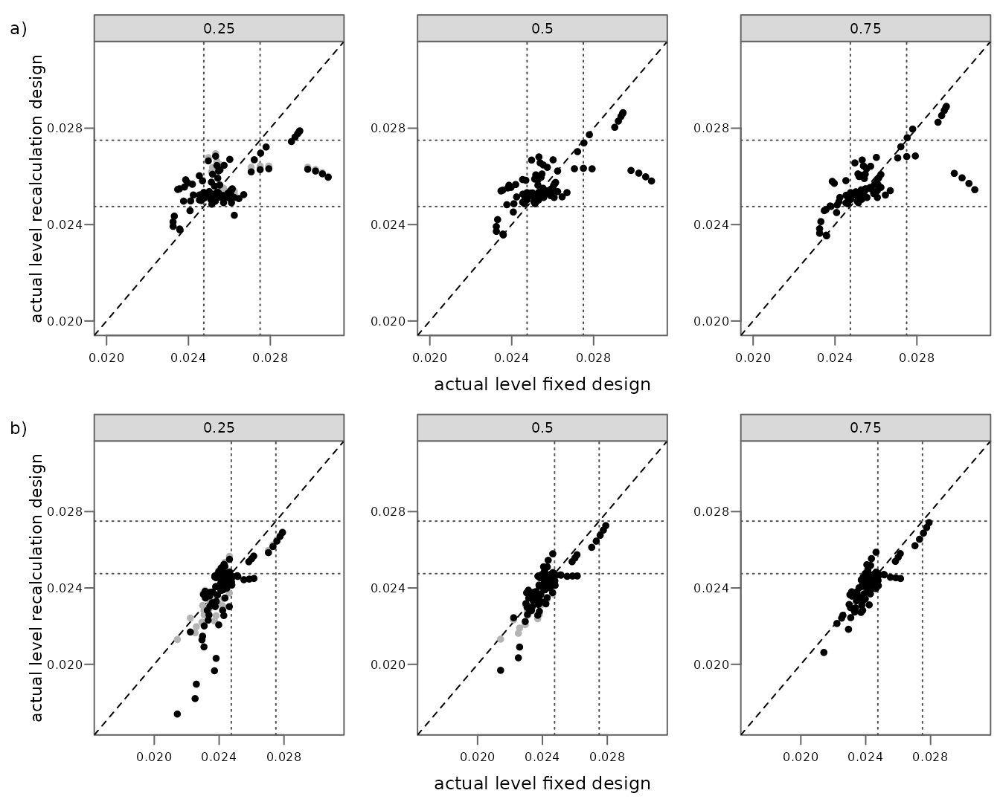

The levels under bbssr (grey) and under the rule that stops after the
pilot (black). For the design of Example 21.1, and so for Figures 21.2
to 21.4, the two rules give the same levels, as the same Python script
confirms over the overall rates of Figure 21.2 (a): the interim outcomes
with a negative recovered rate lead to a recalculated sample size below
the pilot, so the trial ends with the pilot under both rules.

### Figure 21.2 (p. 231)

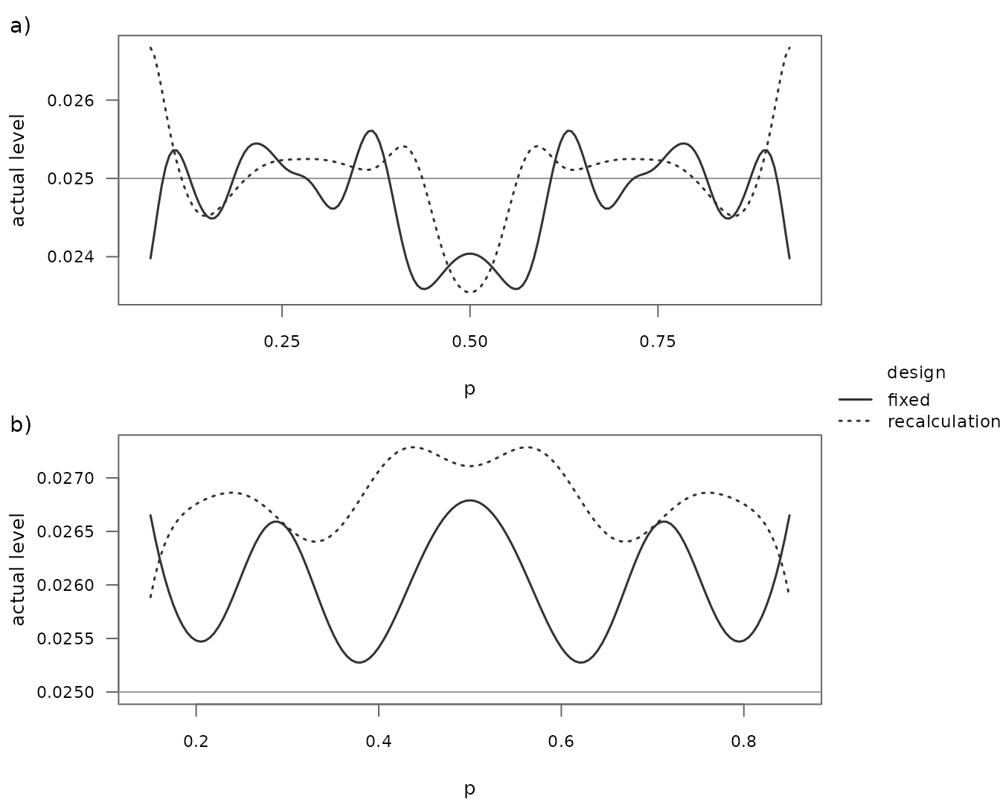

Actual level against the overall rate $`p`$ for Example 21.1 (a) and for
the same design with $`\Delta_A = -0.30`$, $`n_0 = 2 \times 39`$ and a
pilot of $`20 + 20`$ patients (b). The book varies $`p`$ from 0.01 to
0.99 in steps of 0.005 and shows the rates for which the assumed rates
of both groups lie in the unit interval, $`[0.075, 0.925]`$ in (a) and
$`[0.15, 0.85]`$ in (b). The mean, minimum and maximum that the book
reports are computed over these ranges.

| Design                            |   Book |    bbssr | Agrees |
|:----------------------------------|-------:|---------:|:-------|
| a\) fixed design: mean            | 0.0248 | 0.024752 | yes    |
| a\) fixed design: minimum         | 0.0236 | 0.023586 | yes    |
| a\) fixed design: maximum         | 0.0256 | 0.025609 | yes    |
| a\) recalculation design: mean    | 0.0250 | 0.025010 | yes    |
| a\) recalculation design: minimum | 0.0235 | 0.023543 | yes    |
| a\) recalculation design: maximum | 0.0267 | 0.026668 | yes    |
| b\) fixed design: mean            | 0.0260 | 0.025991 | yes    |
| b\) fixed design: minimum         | 0.0253 | 0.025275 | yes    |
| b\) fixed design: maximum         | 0.0268 | 0.026790 | yes    |
| b\) recalculation design: mean    | 0.0268 | 0.026796 | yes    |
| b\) recalculation design: minimum | 0.0259 | 0.025886 | yes    |
| b\) recalculation design: maximum | 0.0273 | 0.027286 | yes    |

All 12 of the 12 values agree, and the curves agree with the original
figure.

### Figure 21.3 (p. 233)

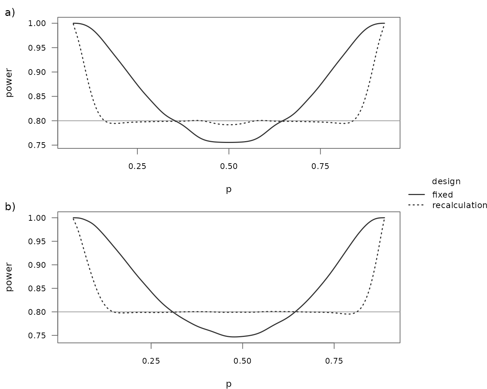

Power against the overall rate $`p`$ for the fixed design and the
recalculation design of Example 21.1 (a) and of the same design with
$`r = 3`$ (b). For $`r = 3`$ the book does not give the sample sizes.
With the rates of Example 21.1 kept, so that the overall rate becomes
$`p_A = 0.3075`$, formula (21.3) gives $`n_E = 306`$ and $`n_C = 102`$,
and with a pilot of half of each group, $`153 + 51`$ patients, the
figure agrees with the original, where the power of the fixed design
falls below 0.8 near this overall rate. A design that keeps
$`p_A = 0.345`$ instead gives a curve of the fixed design that lies
above the original.

### Figure 21.4 (p. 234)

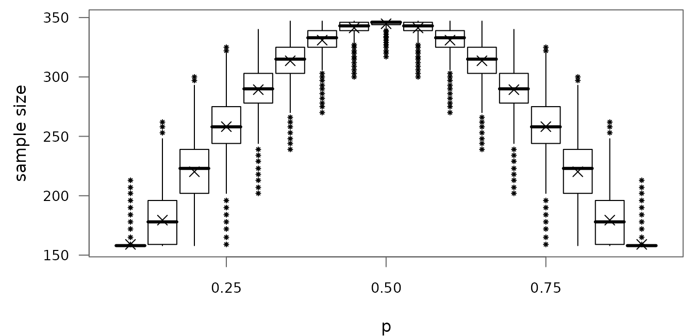

Distribution of the recalculated total sample size of Example 21.1
against the overall rate $`p`$, with the total rounded up as the book
does. The figure is drawn from the exact distribution: the box spans the
quartiles (the smallest totals whose cumulative probability reaches 0.25
and 0.75), the bar marks the median, the cross the mean, and the
whiskers reach the most extreme totals within 1.5 interquartile ranges
of the box. The book does not say whether its box plots come from
simulated trials; the asterisks mark the totals beyond the whiskers
whose probability is at least $`10^{-4}`$, which spans about the same
ranges as the asterisks of the book (for example up to 213 at
$`p = 0.10`$).

For $`p = 0.35`$ the book gives the quartiles 303 and 325 and the median
315, and for $`p = 0.25`$ and $`p = 0.45`$ the medians 258 and 343 and
the interquartile ranges 31 and 7. The recomputed values are 303, 325
and 315, and 258, 343, 31 and 7.

## Kieser (2020), Chapter 23

Example 23.1 of the book (the FreezeAF trial) uses the test of
Farrington and Manning (1990) of the non-inferiority hypothesis
$`p_E - p_C \le -\delta`$ with the margin $`\delta = 0.15`$ at the
one-sided level 0.025, the equal assumed rates
$`p_{C,A} = p_{E,A} = 0.78`$ and the target power 0.8. Formula (23.2)
gives $`n_0 = 244`$ patients in total, the pilot has 100 patients, and
the recalculation is unrestricted. The recalculated total therefore lies
between the 100 patients of the pilot and the 344 patients that formula
(23.2) gives at the overall rate 0.5, the bounds that the book points
out. In bbssr this design is `Test = 'Farrington-Manning'`,
`margin = 0.15`, `Delta.A = 0`, `ss.method = 'standard'` and
`n.interim = c(50, 50)`, with group 1 the experimental group E and each
group rounded up, as in the reproduction of the values of Example 23.1
by `reproduce-published.R`.

### Figure 23.1 (p. 251)

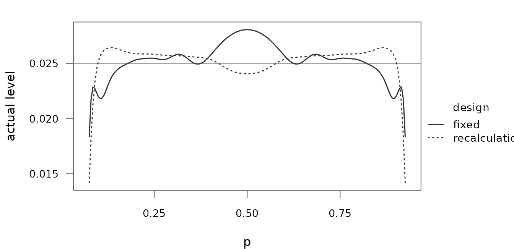

Actual level on the boundary of the null hypothesis, $`p_E = p - 0.075`$
and $`p_C = p + 0.075`$, against the overall rate $`p`$ in
$`[0.075, 0.925]`$, for the fixed design with $`n_0`$ patients and the
internal pilot study design. The book states that it varied $`p`$ in
steps of 0.05, but the maximum it reports at $`p = 0.865`$ lies only on
a grid with steps of 0.005, which is the grid used here.

| Value                                     |   Book |    bbssr | Agrees |
|:------------------------------------------|-------:|---------:|:-------|
| fixed design: maximum level               | 0.0281 | 0.028078 | yes    |
| recalculation design: maximum level       | 0.0264 | 0.026449 | yes    |
| recalculation design: rate of the maximum | 0.8650 | 0.865000 | yes    |

The level is symmetric about $`p = 0.5`$, so the maximum of the
recalculation design is attained at $`p = 0.135`$ as well. 3 of the 3
values agree, and the curves agree with the original figure. The
adjusted levels that the book derives from this figure are reproduced by
`reproduce-published.R`, and the `bbssr-type1-error` vignette uses the
example to illustrate the control of the type I error rate within a
confidence interval.

### Figure 23.2 (p. 252)

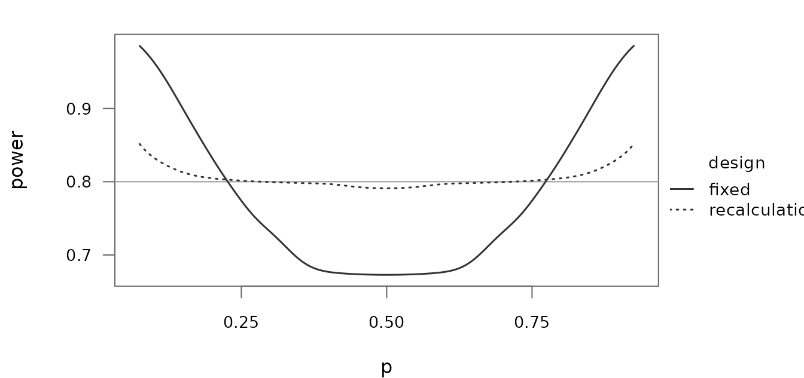

Power for the equal true rates $`p_E = p_C = p`$. The power of the fixed
design falls to 0.6729 near $`p = 0.5`$, while the power of the
recalculation design lies between 0.7911 and 0.8517. The figure agrees
with the original.

### Figure 23.3 (p. 252)

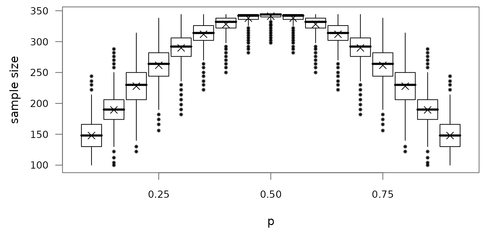

Distribution of the recalculated total sample size against the overall
rate $`p`$, drawn from the exact distribution as Figure 21.4. The book
does not state the true rates, and the figure uses equal rates
$`p_E = p_C = p`$, as for the power in Figure 23.2. The caption of the
book refers to Example 21.1, but its text describes this figure with the
bounds of Example 23.1, and the recomputed totals lie between 100 and
344. The boxes and the asterisks agree with the original to within the
accuracy with which the figure can be read. At a few rates a whisker
ends one attainable total nearer to or farther from the box than in the
original. These are rates at which a total lies close to 1.5
interquartile ranges from the box, so that the end of the whisker
depends on how the quartiles are computed, and the book does not say
whether its box plots come from simulated trials.

## Friede, Mitchell and Mueller-Velten (2007)

The tests have the one-sided level 0.025 and the margin 0.1, the target
power is 0.8 and the assumed treatment difference is 0. The article
writes $`q = n_2 / n_1`$ for the allocation, with group 1 the
experimental group, so $`r = 1 / q`$ in bbssr, and
$`\delta_1 = p_2 - p_1`$ for the treatment difference. The fixed sample
sizes come from formula (1) (Blackwelder) or (2) (Farrington and
Manning) with each group rounded up, the internal pilot study has half
of each group rounded to the nearest integer, and the re-estimated
groups are rounded to the nearest integer, as in the reproduction of
Tables 2 and 3 of the article by `reproduce-published.R`.

### Figure 1 (p. 908)

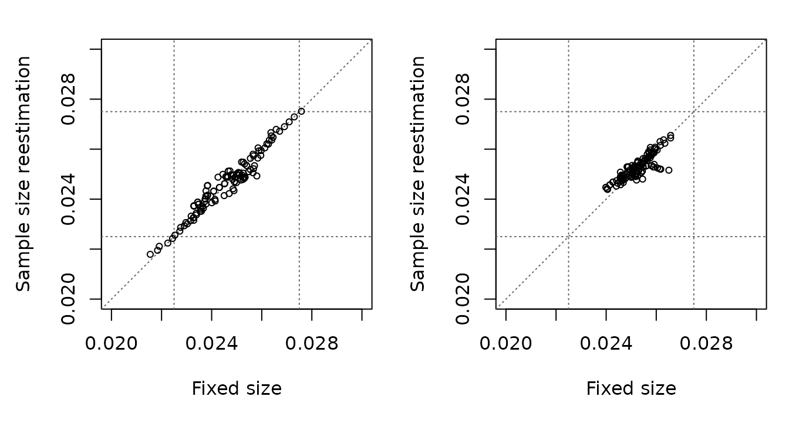

Type I error rate of the re-estimation design against that of the fixed
design for the test of Blackwelder (left) and of Farrington and Manning
(right), on the boundary of the null hypothesis ($`\delta_1 = 0.1`$) at
the assumed overall rate, for $`q = 1/3, 1/2, 1`$ and the assumed
overall rates 0.30, 0.31, …, 0.70 (123 designs per test). The points of
the test of Blackwelder lie along the diagonal between 0.0215 and
0.0276, as in the original. The points of the test of Farrington and
Manning lie between 0.0240 and 0.0266, and those of the original between
about 0.0238 and 0.0264, so the cloud agrees in its shape but not
exactly at its edges.

The article does not simulate. It sums over all outcomes and bounds the
omitted terms, so that each plotted level lies within 0.00005 of the
exact level (Section 4.3 of the article), and the differences are not
simulation error. The level of the test changes by several units in the
fourth decimal when a group gains or loses one patient, and the article
does not state how the sample size of formula (2) is split between the
groups or how the pilot and the re-estimated sample sizes are rounded.
For $`q = 1/3`$ and $`\pi^a = 0.7`$, Table 2 of the article gives only
the total of 815 patients. bbssr allocates them as 611 + 204, for which
the level of the fixed design is 0.0266. One patient fewer in group 1
gives 0.0262, and the other splits 610 + 205 and 612 + 203 give 0.0264
and 0.0266. The levels of all fixed designs of the figure, and the
levels of these four splits, agree with an independent computation in
Python (`tools/reference/check_friede_2007_figure1.py` in the source
repository), which finds the restricted maximum likelihood estimates by
bisection on the score equation rather than by the closed form of
Farrington and Manning (1990).

### Figure 2 (p. 909)

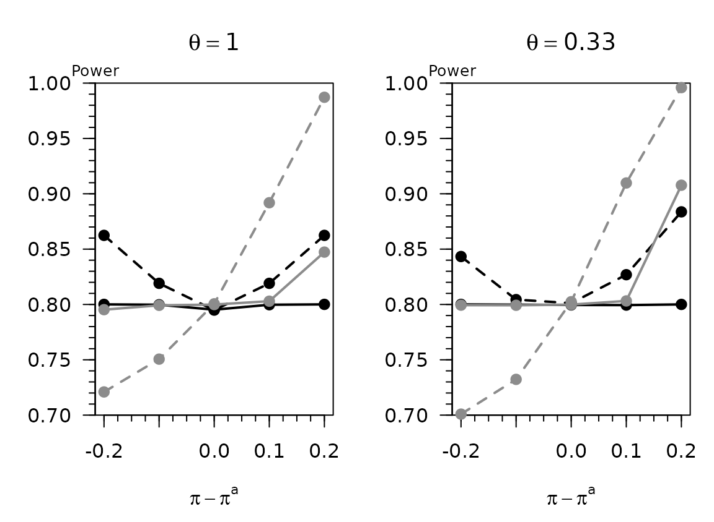

Power of the test of Farrington and Manning against the difference
between the true and the assumed overall rate, for the fixed design
(dashed) and the re-estimation design (solid), $`\pi^a = 0.5`$ (black)
and $`\pi^a = 0.7`$ (grey), and the correctly specified difference
$`\delta_1 = \delta_1^a = 0`$. The figure agrees with the original.

### Figure 3 (p. 911)

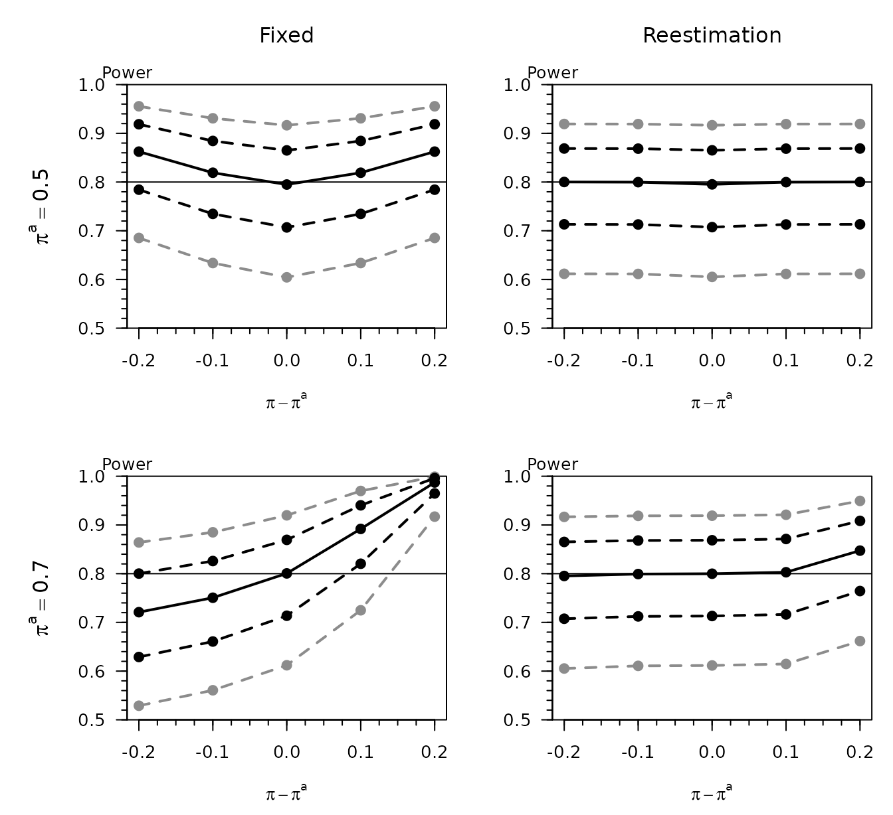

Power of the test of Farrington and Manning with $`q = 1`$ for the true
differences $`\delta_1 - \delta_1^a = 0`$ (solid black), $`\pm 0.01`$
(dashed black) and $`\pm 0.02`$ (dashed grey), in the fixed design
(left) and the re-estimation design (right). The figure agrees with the
original.

## Boschloo (1970)

### Figure 2 (p. 3)


Unconditional level of significance of Fisher’s test of $`p_1 \le p_2`$
against $`p_1 > p_2`$ with $`m = 15`$ and $`n = 10`$ at the conditional
level $`\alpha = 0.05`$, $`\alpha(p) = \sum_r f_r(p)`$ with
$`f_r(p) = \alpha_r P(R = r \mid H_0)`$, where $`\alpha_r`$ is the
conditional size given the total number of successes $`r`$, together
with $`f_r(p)`$ for $`r = 6, 10, 17, 21`$ and the level
$`\alpha_\gamma(p)`$ of Fisher’s test at the raised conditional level
$`\gamma = 0.09`$. The circles mark the maximum of $`f_r(p)`$, at
$`p = r/25`$, for every $`r`$; the caption of the article calls them
crosses, but the figure draws small circles. The largest values of
$`\alpha(p)`$ and $`\alpha_\gamma(p)`$ are 0.0203 and 0.0435, and the
figure agrees with the original. Rejecting with Fisher’s test at the
level 0.09 is the same as rejecting with the Boschloo test at the level
0.05, and `reproduce-figures.R` confirms that the two levels agree.

## Berger and Sidik (2003)

### Figure 2 (p. 105)

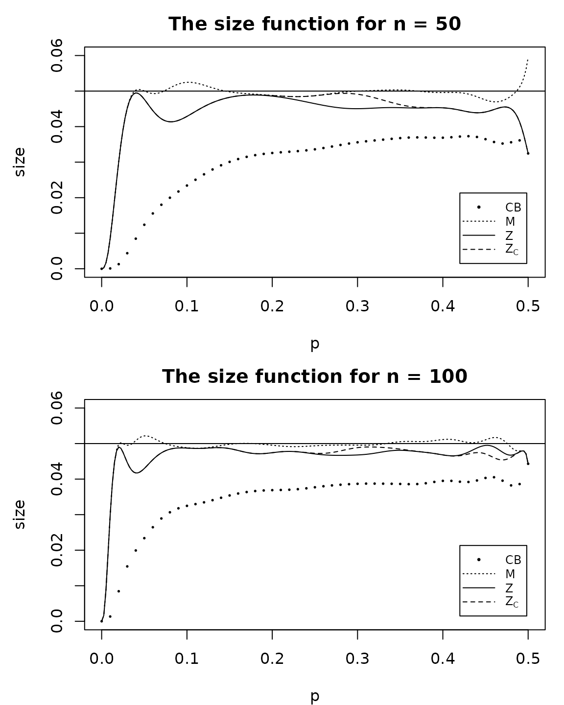

Size functions of the tests of $`p_{10} \le p_{01}`$ against
$`p_{10} > p_{01}`$ at the one-sided level 0.05 for $`n = 50`$ and
$`n = 100`$ pairs, the rejection probabilities at
$`p_{01} = p_{10} = p`$: the exact conditional test CB
(`'McNemar-exact'`), the asymptotic McNemar test M (`'McNemar'`), the
exact unconditional test Z (`'McNemar-uncond'`) and the same with the
Berger-Boos procedure, $`Z_C`$ (`bb.gamma = 0.0005`), both with
`ref.pvalue = TRUE`. The likelihood ratio tests L and $`L_C`$ of the
article are not available in bbssr and are not drawn; the article states
that they coincide with Z and $`Z_C`$ for $`n = 50`$. As in the
original, the size function of M rises above 0.05 for both numbers of
pairs, to 0.0595 and 0.0522, that of CB stays well below 0.05, and those
of Z and $`Z_C`$ stay below 0.05 and close to it for $`n = 100`$. The
largest values on the grid of the figure ($`p`$ in steps of 0.0025)
differ from the exact sizes in Table 4 of the article by at most
0.00006; `reproduce-published.R` reproduces that table with the maximum
over all $`p`$.

## Fagerland, Lydersen and Laake (2013)

Both figures show the five tests of the article at the two-sided level
0.05: the asymptotic McNemar test (`'McNemar'`), the same with the
continuity correction of formula (2) of the article (`'McNemar-cc'`),
the exact conditional test (`'McNemar-exact'`), its mid-p version
(`'McNemar-midP'`) and the exact unconditional test (`'McNemar-uncond'`
with `ref.pvalue = TRUE`). The article specifies a pair by the marginal
success probabilities $`p_{1+}`$ and $`p_{+1}`$ and the odds ratio
$`\theta = p_{11} p_{22} / (p_{12} p_{21})`$, but does not state how
$`p_{11}`$ is obtained from them. The figures take $`p_{11}`$ as the
root of $`p_{11} p_{22} = \theta p_{12} p_{21}`$ within the bounds given
by the margins, so that $`p_{12} = p_{1+} - p_{11}`$ and
$`p_{21} = p_{+1} - p_{11}`$. With this choice `reproduce-published.R`
reproduces the summaries of the type I error rates in Table 4 of the
article for the first four tests, but not all of those for the exact
unconditional test, which the article computed with StatXact.

### Figure 1 (p. 4)

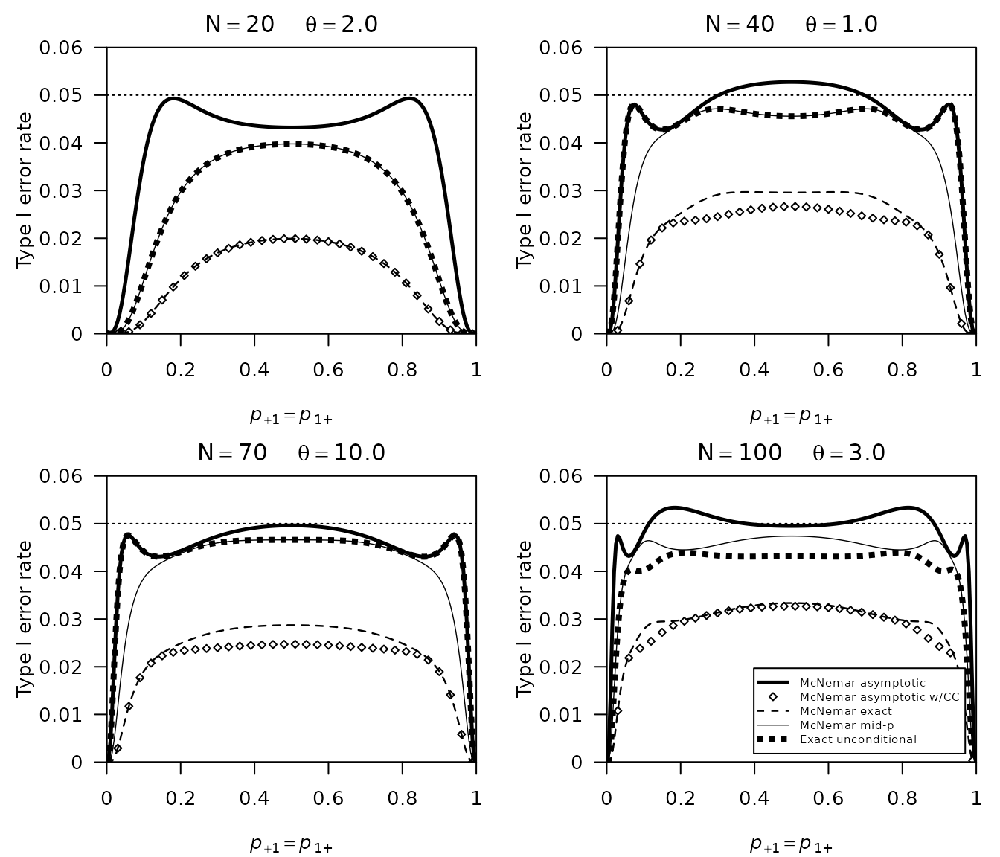

Type I error rates against $`p_{1+} = p_{+1}`$ for
$`(N, \theta) = (20, 2)`$, $`(40, 1)`$, $`(70, 10)`$ and $`(100, 3)`$,
the panels of the original, which the article does not list in the text.
The curves and the diamonds agree with the original for all five tests.
The largest type I error rate of the asymptotic test in the four panels
is 0.0534, and that of the test with continuity correction 0.0327.

### Figure 2 (p. 6)

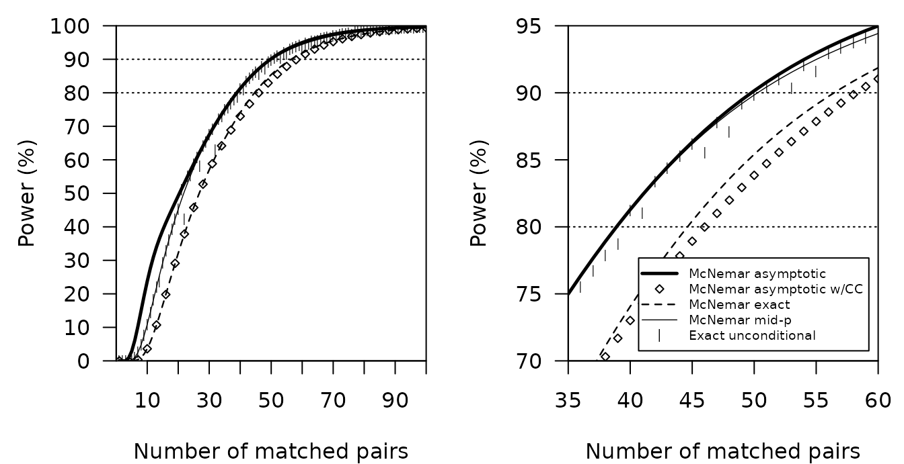

Power against the number of matched pairs $`N`$ for $`p_{1+} = 0.1`$,
$`p_{+1} = 0.35`$ and $`\theta = 2`$, with the range $`35 \le N \le 60`$
on the right. With 50 pairs the power is 0.9015 for the asymptotic test,
0.8384 with continuity correction, 0.8541 for the exact conditional
test, 0.8983 for the mid-p test and 0.8983 for the exact unconditional
test. The curves agree with the original, except the exact unconditional
test at $`N = 27`$, 32, 60, 76 and 85. At these numbers of pairs the
original lies above the recomputed power, at about the power of the
asymptotic or the mid-p test; at $`N = 60`$ the recomputed power is
0.9289 and that of the mid-p test 0.9443. The exact unconditional test
of the article thus rejects more often at some numbers of pairs, in the
same direction as the means in Table 4 of the article that
`reproduce-published.R` does not reproduce.

## Schepers et al. (2026)

Both figures use the two-sided exact conditional McNemar test at the
level 0.05 and $`n^{(1)} = 38`$ interim pairs, of which $`n_d^{(1)}`$
are discordant, and show the conditional power (4) of the article
against $`p_*`$, the probability that a discordant pair favours
treatment 1. The conditional power needs the probability $`\psi`$ of a
discordant pair in the second stage. The article generated the figures
with the assumptions of its motivating trial, among them $`\psi = 0.2`$,
while its re-estimation rule (Section 2.4) uses the interim estimate
$`\hat{\psi} = n_d^{(1)} / n^{(1)}`$. The figures are drawn with
$`\psi = 0.2`$, with which they agree with the original. With the
interim estimate, the contour of 80% would be crossed at
$`n_d^{(1)} = 20`$ at $`p_* =`$ 0.73 instead of 0.78.

### Figure 1 (p. 5)

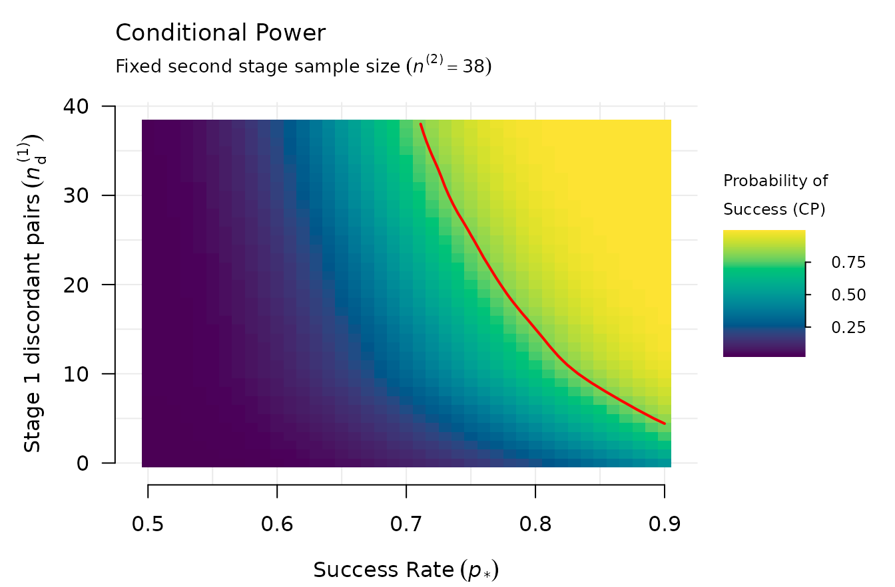

Conditional power with the fixed second-stage size $`n^{(2)} = 38`$ for
$`p_* = 0.50, 0.51, \ldots, 0.90`$ and $`n_d^{(1)} = 0, 1, \ldots, 38`$,
with the contour of 80% in red.

### Figure 2 (p. 6)

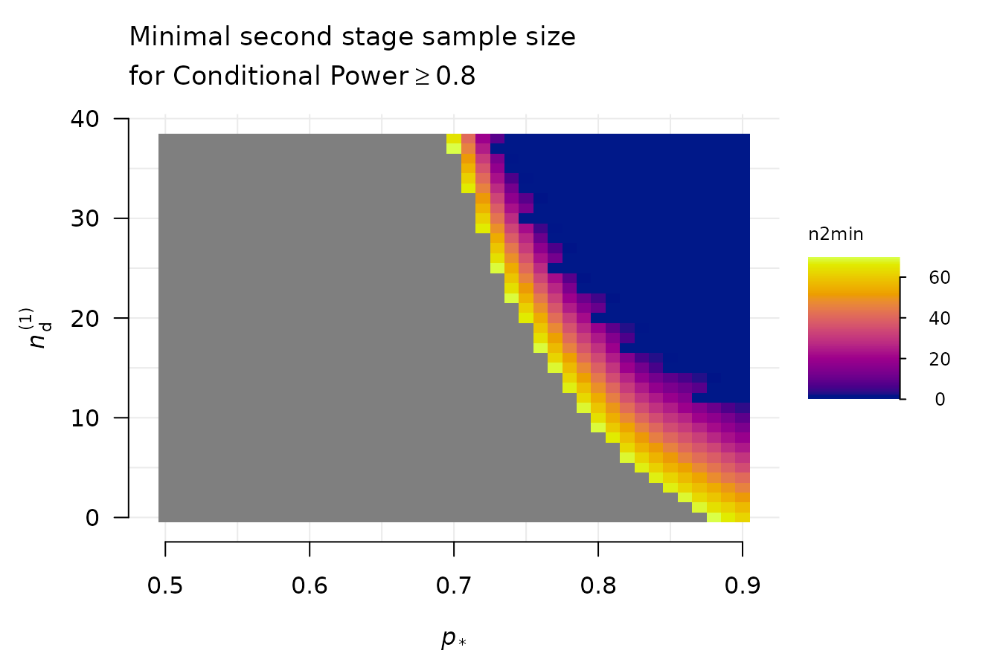

Smallest second-stage size $`n^{(2)}`$ with a conditional power of at
least 0.8; the cells where no $`n^{(2)}`$ up to 70 attains it are grey.
The article does not state the largest second-stage size, and the grey
cells of the original agree with 70. With the largest size 69, 2 more
cells would be grey, those that need exactly 70 further pairs, and with
71, 3 fewer.

## Agreement of the stored values with the package

The stored values were computed with bbssr by `reproduce-figures.R` and
`reproduce-figures-paired.R`. The code below recomputes some of them,
from the designs that take little time, with the installed version of
the package, and stops if a stored value differs from the recomputed one
by more than $`10^{-10}`$. The designs of Friede et al. (2007) take
several seconds each and are not recomputed here; the same computations
reproduce Tables 2 and 3 of the article in `reproduce-published.R`. The
conditional power of Schepers et al. (2026) is computed by an internal
function of the package and is not recomputed here.

``` r

fk1 <- read_fig(dir, 'friede-kieser-2004-figure1.csv')
fk4 <- read_fig(dir, 'friede-kieser-2004-figure4-recalculation.csv')
K <- (qnorm(0.975) + qnorm(0.8))^2
# Friede and Kieser (2004), Figure 1: pi = 0.1, n = 60 and a pilot of 20 patients
fk1.ips <- BinaryPowerBSSR(
  p = 0.1, Delta.A = sqrt(4 * K * 0.1 * (1 - 0.1) / 60), Delta.T = 0, N1 = 30, N2 = 30,
  n.interim = c(10, 10), r = 1, alpha = 0.05, tar.power = 0.8, Test = 'Chisq',
  alternative = 'two.sided', ss.method = 'null.variance', rounding = 'friede-kieser',
  N.max = 120
)$power.BSSR
# Friede and Kieser (2004), Figure 4: required total n = 100
fk4.row <- fk4[fk4$n == 100, ]
fk4.ips <- BinaryPowerBSSR(
  p = fk4.row$pi, Delta.A = 0.15, Delta.T = 0, N1 = 122, N2 = 122, n.interim = c(60, 60),
  r = 1, alpha = 0.05, tar.power = 0.8, Test = 'Chisq', alternative = 'two.sided',
  ss.method = 'null.variance', rounding = 'friede-kieser', N.max = 200
)$power.BSSR
# Kieser (2020), Figure 21.1: r = 3, pA = 0.30, Delta = 0.30 and a pilot of 25 per cent
k1.row <- k1[k1$r == 3 & k1$pA == 0.3 & k1$Delta == 0.3 & k1$fraction == 0.25, ]
k1.ss <- BinarySampleSize(0.3 + 0.3 / 4, 0.3 - 3 * 0.3 / 4, 3, 0.025, 0.8, 'Chisq',
                          method = 'standard')
k1.res <- BinaryPowerBSSR(
  p = 0.3, Delta.A = 0.3, Delta.T = 0, N1 = k1.ss$N1, N2 = k1.ss$N2,
  n.interim = c(3 * ceiling(k1.ss$N2 / 4), ceiling(k1.ss$N2 / 4)), r = 3, alpha = 0.025,
  tar.power = 0.8, Test = 'Chisq', ss.method = 'standard'
)
# Kieser (2020), Figure 21.2 b: the overall rate 0.5
k2.row <- k2[k2$Delta == -0.30 & abs(k2$p - 0.5) < 1e-9, ]
k2.res <- BinaryTypeIErrorBSSR(
  Delta.A = -0.30, N1 = 39, N2 = 39, n.interim = c(20, 20), r = 1, alpha = 0.025,
  tar.power = 0.8, Test = 'Chisq', alternative = 'less', ss.method = 'standard',
  theta = k2.row$p, maximize = 'grid'
)
# Kieser (2020), Figure 23.1: the overall rate 0.865
k23.row <- k23.1[abs(k23.1$p - 0.865) < 1e-9, ]
k23.res <- BinaryTypeIErrorBSSR(
  Delta.A = 0, N1 = 122, N2 = 122, n.interim = c(50, 50), r = 1, alpha = 0.025,
  tar.power = 0.8, Test = 'Farrington-Manning', ss.method = 'standard', margin = 0.15,
  theta = 0.865, maximize = 'grid'
)
# Boschloo (1970), Figure 2: p = 0.5
bo.row <- bo[abs(bo$p - 0.5) < 1e-9, ]
# Berger and Sidik (2003), Figure 2: n = 50 and p = 0.25
bs.row <- bs[bs$n == 50 & abs(bs$p - 0.25) < 1e-9, ]
# Fagerland et al. (2013), Figure 1: N = 40, theta = 1 and p1+ = p+1 = 0.5, so that
# p11 = 0.25; Figure 2: N = 50, with p11 the root of p11 p22 = 2 p12 p21
fll1.row <- fll1[fll1$N == 40 & abs(fll1$p - 0.5) < 1e-9, ]
fll2.row <- fll2[fll2$N == 50, ]
fll.b <- 1 + (2 - 1) * (0.1 + 0.35)
fll.p11 <- 2 * 2 * 0.1 * 0.35 / (fll.b + sqrt(fll.b^2 + 4 * 2 * (1 - 2) * 0.1 * 0.35))
check <- data.frame(
  Value = c('FK2004 Figure 1', 'FK2004 Figure 4', 'Kieser Figure 21.1, fixed',
            'Kieser Figure 21.1, recalculation', 'Kieser Figure 21.2, fixed',
            'Kieser Figure 21.2, recalculation', 'Kieser Figure 23.1, fixed',
            'Kieser Figure 23.1, recalculation', 'Boschloo Figure 2, alpha',
            'Boschloo Figure 2, alpha_gamma', 'BS2003 Figure 2, Z',
            'BS2003 Figure 2, Z_C', 'FLL2013 Figure 1, continuity correction',
            'FLL2013 Figure 2, mid-p'),
  Stored = c(fk1$pilot.20[fk1$pi == 0.1 & fk1$n == 60], fk4.row$level, k1.row$fixed,
             k1.row$ips, k2.row$fixed, k2.row$recalculation, k23.row$fixed,
             k23.row$recalculation, bo.row$alpha, bo.row$alpha.gamma, bs.row$Z, bs.row$Z.C,
             fll1.row$cc, fll2.row$midp),
  Recomputed = c(fk1.ips, fk4.ips, k1.res$power.TRAD, k1.res$power.BSSR,
                 k2.res$TIE.TRAD, k2.res$TIE.BSSR, k23.res$TIE.TRAD, k23.res$TIE.BSSR,
                 BinaryPower(0.5, 0.5, 15, 10, 0.05, 'Fisher')$Power,
                 BinaryPower(0.5, 0.5, 15, 10, 0.09, 'Fisher')$Power,
                 PairedPower(0.25, 0.25, 50, 0.05, 'McNemar-uncond',
                             ref.pvalue = TRUE)$Power,
                 PairedPower(0.25, 0.25, 50, 0.05, 'McNemar-uncond', bb.gamma = 5e-4,
                             ref.pvalue = TRUE)$Power,
                 PairedPower(0.25, 0.25, 40, 0.05, 'McNemar-cc', 'two.sided')$Power,
                 PairedPower(0.1 - fll.p11, 0.35 - fll.p11, 50, 0.05, 'McNemar-midP',
                             'two.sided')$Power)
)
check$Difference <- abs(check$Stored - check$Recomputed)
knitr::kable(check, digits = 12)
```

| Value                                   |     Stored | Recomputed | Difference |
|:----------------------------------------|-----------:|-----------:|-----------:|
| FK2004 Figure 1                         | 0.03686087 | 0.03686087 |          0 |
| FK2004 Figure 4                         | 0.05009993 | 0.05009993 |          0 |
| Kieser Figure 21.1, fixed               | 0.02142053 | 0.02142053 |          0 |
| Kieser Figure 21.1, recalculation       | 0.02130180 | 0.02130180 |          0 |
| Kieser Figure 21.2, fixed               | 0.02679047 | 0.02679047 |          0 |
| Kieser Figure 21.2, recalculation       | 0.02710920 | 0.02710920 |          0 |
| Kieser Figure 23.1, fixed               | 0.02376426 | 0.02376426 |          0 |
| Kieser Figure 23.1, recalculation       | 0.02644929 | 0.02644929 |          0 |
| Boschloo Figure 2, alpha                | 0.02016771 | 0.02016771 |          0 |
| Boschloo Figure 2, alpha_gamma          | 0.04336041 | 0.04336041 |          0 |
| BS2003 Figure 2, Z                      | 0.04645488 | 0.04645488 |          0 |
| BS2003 Figure 2, Z_C                    | 0.04868590 | 0.04868590 |          0 |
| FLL2013 Figure 1, continuity correction | 0.02665621 | 0.02665621 |          0 |
| FLL2013 Figure 2, mid-p                 | 0.89834090 | 0.89834090 |          0 |

``` r

stopifnot(max(check$Difference) < 1e-10)
```

## References

Berger, R. L. and Sidik, K. (2003). Exact unconditional tests for a 2 ×
2 matched-pairs design. *Statistical Methods in Medical Research*, 12,
91-108.

Boschloo, R. D. (1970). Raised conditional level of significance for the
2 × 2-table when testing the equality of two probabilities. *Statistica
Neerlandica*, 24, 1-9.

Fagerland, M. W., Lydersen, S. and Laake, P. (2013). The McNemar test
for binary matched-pairs data: mid-p and asymptotic are better than
exact conditional. *BMC Medical Research Methodology*, 13, 91.

Farrington, C. P. and Manning, G. (1990). Test statistics and sample
size formulae for comparative binomial trials with null hypothesis of
non-zero risk difference or non-unity relative risk. *Statistics in
Medicine*, 9, 1447-1454.

Friede, T. and Kieser, M. (2004). Sample size recalculation for binary
data in internal pilot study designs. *Pharmaceutical Statistics*, 3,
269-279.

Friede, T., Mitchell, C. and Mueller-Velten, G. (2007). Blinded sample
size reestimation in non-inferiority trials with binary endpoints.
*Biometrical Journal*, 49, 903-916.

Kieser, M. (2020). *Methods and Applications of Sample Size Calculation
and Recalculation in Clinical Trials*. Springer.

Schepers, M., Brannath, W., Hoffmann, E., Stingl, J. and Schmidtmann, I.
(2026). Blinded sample size review for McNemar’s test based on primary
and surrogate endpoints. arXiv:2608.17784.
