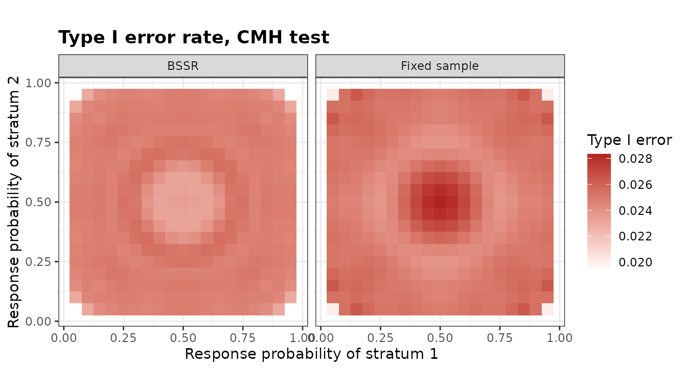

# Stratified Designs

``` r

library(bbssr)
```

## Design and notation

A trial is stratified into $`J \ge 2`$ strata, for example by centre or
by a baseline factor, and stratum $`j`$ has $`N_{1j}`$ patients in group
1 and $`N_{2j}`$ in group 2, both fixed by the design. Let $`x_{1j}`$
and $`x_{2j}`$ be the numbers of responders of the two groups and
$`z_j = x_{1j} + x_{2j}`$ the number of responders of the stratum. All
tests of the `Strat*` functions use $`S = \sum_j x_{1j}`$, the number of
responders of group 1 summed over the strata. Given
$`z = (z_1, \ldots, z_J)`$, the null expectation of $`S`$ is
$`E = \sum_j N_{1j} z_j / N_j`$ with $`N_j = N_{1j} + N_{2j}`$, and each
test rejects when $`S`$ is at most a lower or at least an upper critical
value.

The functions follow those for two independent groups:
[`StratRR()`](https://gosukehommaex.github.io/bbssr/reference/StratRR.md),
[`StratPower()`](https://gosukehommaex.github.io/bbssr/reference/StratPower.md)
and
[`StratSampleSize()`](https://gosukehommaex.github.io/bbssr/reference/StratSampleSize.md)
for the fixed design, and
[`StratPowerBSSR()`](https://gosukehommaex.github.io/bbssr/reference/StratPowerBSSR.md),
[`StratBSSR()`](https://gosukehommaex.github.io/bbssr/reference/StratBSSR.md),
[`StratTypeIErrorBSSR()`](https://gosukehommaex.github.io/bbssr/reference/StratTypeIErrorBSSR.md)
and
[`StratAlphaAdjBSSR()`](https://gosukehommaex.github.io/bbssr/reference/StratAlphaAdjBSSR.md)
for blinded sample size re-estimation.

## Tests

Five stratified tests are available. `'CMH'` is the
Cochran-Mantel-Haenszel statistic $`(S - E) / \sqrt{V}`$ with the
hypergeometric variance
$`V = \sum_j N_{1j} N_{2j} z_j (N_j - z_j) / \{N_j^2 (N_j - 1)\}`$, and
`'Cochran'` is Cochran’s statistic with the binomial variance
$`\sum_j N_{1j} N_{2j} z_j (N_j - z_j) / N_j^3`$, the statistic of
Woolson et al. (1986). `'CMH-cc'` and `'Cochran-cc'` reduce $`|S - E|`$
by 0.5 when it is at least 0.5, the continuity correction of
[`stats::mantelhaen.test()`](https://rdrr.io/r/stats/mantelhaen.test.html).
Nam (1992) reduces $`S - E`$ by 0.5 in every outcome; the two
corrections reject the same outcomes at one-sided levels up to 0.078,
since an outcome with $`|S - E| < 0.5`$ has a larger one-sided p-value.
`'Strat-Fisher'` is the stratified exact conditional test of Jung
(2014), which refers $`S`$ to its distribution given $`z`$, the
convolution of the hypergeometric distributions of the strata. Three
unstratified tests, which analyse the table of totals and ignore the
strata, are available for comparison (see [Analyses that ignore the
strata](#analyses-that-ignore-the-strata)).

Jung (2014, Table 2) analyses the response to thymosin in three strata
of patients with bronchogenic carcinoma.

``` r

thymosin <- array(c(10, 12, 1, 1, 9, 11, 0, 1, 8, 7, 0, 3), c(2, 2, 3))
p.exact <- stats::mantelhaen.test(thymosin, alternative = 'greater', exact = TRUE)$p.value
p.mh <- stats::mantelhaen.test(thymosin, alternative = 'greater', correct = FALSE)$p.value
round(c(exact = p.exact, mh = p.mh), 4)
#>  exact     mh 
#> 0.1563 0.0760
```

The one-sided p-values 0.1563 and 0.0760 are those of Jung (2014) for
the stratified exact test and the Mantel-Haenszel test, which
`'Strat-Fisher'` and `'CMH'` compute in the same way.
[`StratRR()`](https://gosukehommaex.github.io/bbssr/reference/StratRR.md)
lists the critical values of a design for every vector of stratum
totals.

``` r

rr <- StratRR(N1 = c(10, 12), N2 = c(10, 12), alpha = 0.025, Test = 'Strat-Fisher')
print(rr, n = 6)
#> Rejection region of a stratified test
#> 
#>   Test             : Strat-Fisher
#>   Alternative      : greater
#>   Group sizes      : N1 = (10, 12), N2 = (10, 12)
#>   Alpha            : 0.025
#>   Combinations     : 525, of which 457 have a rejected value of S
#> 
#>  z.S1 z.S2 S.min S.max lower upper
#>     5    0     0     5    NA     5
#>     6    0     0     6    NA     6
#>     7    0     0     7    NA     7
#>     8    0     0     8    NA     7
#>     9    0     0     9    NA     8
#>    10    0     0    10    NA     8
#>   ... 451 more rows
```

## Power and sample size

The power is the probability of the rejection region when the numbers of
responders are binomial in every group and stratum. It is computed
exactly for any number of strata and any response probabilities, so the
odds ratio need not be common to the strata. The normal approximation to
the total sample size is formula (2.8) of Woolson et al. (1986), and
with a continuity correction formula (2.3) of Nam (1992). A design is
described by the fractions of the strata and the allocation ratio, and
the exact search runs over the total sample size within this family.

``` r

p2 <- c(0.3, 0.5)
p1 <- p2 * 2.5 / (1 - p2 + p2 * 2.5)
ss.std <- StratSampleSize(p1, p2, frac = c(0.4, 0.6), alpha = 0.025, tar.power = 0.8,
                          Test = 'CMH', method = 'standard')
ss.cmh <- StratSampleSize(p1, p2, frac = c(0.4, 0.6), alpha = 0.025, tar.power = 0.8,
                          Test = 'CMH')
ss.exact <- StratSampleSize(p1, p2, frac = c(0.4, 0.6), alpha = 0.025, tar.power = 0.8,
                            Test = 'Strat-Fisher')
c(standard = ss.std$N, CMH = ss.cmh$N, exact = ss.exact$N)
#> standard      CMH    exact 
#>      160      164      176
```

With a common odds ratio of 2.5, the normal approximation gives a total
of 160 patients, at which the exact power of the CMH test is 0.796. The
exact search gives 164 patients for the CMH test and 176 for the
stratified exact test, whose conditional control of the type I error
rate makes it conservative.

## Blinded sample size re-estimation

At an interim analysis the numbers of responders of every stratum can be
counted without unblinding. The blinded estimate of the pooled response
probability of stratum $`j`$ is $`s_j`$ divided by the interim size of
the stratum. It is divided between the groups with the assumed effect
`Delta.A`, common to the strata on the scale `effect`, and the total
sample size is re-estimated for these probabilities and divided between
the strata as in the planned design. With two strata the final sizes
depend on the interim data only through $`(s_1, s_2)`$, and the power is
computed exactly by enumeration. With a common odds ratio the planning
probabilities of a stratum whose pooled estimate is close to 0 or 1 are
close to each other, so the examples bound the final total by twice the
planned total with `N.max`.

``` r

plan <- StratSampleSize(p1, p2, frac = c(0.5, 0.5), alpha = 0.025, tar.power = 0.8,
                        Test = 'CMH', method = 'standard')
pooled <- (p1 + p2) / 2
res <- StratPowerBSSR(p = rbind(pooled, pooled + 0.1), Delta.A = 2.5, Delta.T = 2.5,
                      N1 = plan$N1, N2 = plan$N2, omega = 0.5, r = 1, alpha = 0.025,
                      tar.power = 0.8, Test = 'CMH', effect = 'OR',
                      ss.method = 'standard', N.max = 2 * plan$N)
res
#> Blinded sample size re-estimation for a stratified design
#> 
#>   Test             : CMH
#>   Alternative      : greater
#>   Re-estimation    : normal approximation (unrestricted)
#>   Planned sizes    : (40, 40) and (40, 40)
#>   Interim sizes    : (20, 20) and (20, 20)
#>   Effect           : OR, assumed 2.5, true 2.5
#>   Alpha            : 0.025, target power 0.8
#> 
#>       p.S1      p.S2     p1.S1     p1.S2     p2.S1     p2.S2 power.BSSR
#>  0.4086207 0.6071429 0.5172414 0.7142857 0.3000000 0.5000000     0.8122
#>  0.5086207 0.7071429 0.6211596 0.7995566 0.3960818 0.6147291     0.8145
#>  power.TRAD    E.N
#>      0.7963 166.43
#>      0.7821 175.75
```

When the pooled response probabilities are those of the planning (the
first row), the power of the re-estimation design is 0.812 with an
expected total of 166.4. When they are 0.1 higher in both strata, the
re-estimation adjusts the sample size and the power is 0.814, while that
of the fixed design is 0.782.

## Type I error rate

Under the null hypothesis both groups of stratum $`j`$ respond with the
probability $`\theta_j`$. Given the interim and the second-stage numbers
of responders of a stratum, the numbers of responders of group 1 are
hypergeometric whatever $`\theta_j`$, so with two strata the type I
error rate is a polynomial in $`(\theta_1, \theta_2)`$.
[`StratTypeIErrorBSSR()`](https://gosukehommaex.github.io/bbssr/reference/StratTypeIErrorBSSR.md)
computes its coefficients in the products of the Bernstein bases of the
two strata, evaluates it on a grid, and certifies its largest value over
the rectangle spanned by the grid: the rectangle is subdivided until the
largest coefficient of every piece exceeds the largest value found by at
most $`10^{-12}`$.

``` r

tie <- StratTypeIErrorBSSR(Delta.A = 2.5, N1 = c(20, 20), N2 = c(20, 20), omega = 0.5,
                           r = 1, alpha = 0.025, tar.power = 0.8, Test = 'CMH',
                           effect = 'OR', ss.method = 'standard', N.max = 160,
                           theta = seq(0.05, 0.95, by = 0.05))
tie
#> Type I error rate of blinded sample size re-estimation for a stratified design
#> 
#>   Test             : CMH
#>   Alternative      : greater
#>   Planned sizes    : (20, 20) and (20, 20)
#>   Points           : 361
#>   Maximum          : certified over (theta.S1, theta.S2) in [0.05, 0.95] x [0.05, 0.95]
#>   Alpha            : 0.025
#> 
#>        Design  theta.S1  theta.S2       TIE     bound
#>          BSSR 0.3401352 0.3401352 0.0255490 0.0255490
#>  Fixed sample 0.5000000 0.5000000 0.0283368 0.0283368
mx <- attr(tie, 'max')
```

The largest type I error rate of the re-estimation design with 20
patients per group and stratum is 0.02555, at $`(\theta_1, \theta_2) =`$
(0.340, 0.340), and no rate in the rectangle exceeds 0.02555. That of
the fixed design is 0.02834.

``` r

plot(tie)
```



[`StratAlphaAdjBSSR()`](https://gosukehommaex.github.io/bbssr/reference/StratAlphaAdjBSSR.md)
lowers the nominal level until the certified largest rate does not
exceed `alpha`.

``` r

adj <- StratAlphaAdjBSSR(Delta.A = 2.5, N1 = c(20, 20), N2 = c(20, 20), omega = 0.5,
                         r = 1, alpha = 0.025, tar.power = 0.8, Test = 'CMH',
                         effect = 'OR', ss.method = 'standard', N.max = 160,
                         theta = seq(0.05, 0.95, by = 0.05))
adj
#> Adjusted significance level for blinded sample size re-estimation
#> 
#>   Test            : CMH
#>   Alternative     : greater
#>   Adjusted part   : final analysis only
#>   Maximum         : certified over (theta.S1, theta.S2) in [0.05, 0.95] x [0.05, 0.95]
#>   Target level    : 0.025
#> 
#>        Design   max.TIE alpha.adj max.TIE.adj
#>          BSSR 0.0255490 0.0245872   0.0248681
#>  Fixed sample 0.0283368 0.0228356   0.0246744
```

[`StratCondRejectBSSR()`](https://gosukehommaex.github.io/bbssr/reference/StratCondRejectBSSR.md)
gives, under the null hypothesis, the probability of rejection given the
pooled numbers of responders of the strata at the interim analysis and
in the second stage. These probabilities do not depend on
$`(\theta_1, \theta_2)`$, and averaging them over the second stage gives
the type I error rate given the interim outcome. Below they are
evaluated at the point of the largest rate found above.

``` r

crp <- StratCondRejectBSSR(Delta.A = 2.5, N1 = c(20, 20), N2 = c(20, 20), omega = 0.5,
                           r = 1, alpha = 0.025, tar.power = 0.8, Test = 'CMH',
                           effect = 'OR', ss.method = 'standard', N.max = 160,
                           theta = cbind(mx$theta.S1[1], mx$theta.S2[1]))
#> Warning in data.frame(theta.S1 = pts[p, 1], theta.S2 = pts[p, 2], s1 = map$s1,
#> : row names were found from a short variable and have been discarded
crp
#> Conditional rejection probabilities of blinded sample size re-estimation
#> for a stratified design, under equal response probabilities in every stratum
#> 
#>   Test             : CMH
#>   Alternative      : greater
#>   Planned sizes    : (20, 20) and (20, 20)
#>   Interim sizes    : (10, 10) and (10, 10)
#>   Assumed effect   : 2.5 (OR)
#>   Nominal level    : 0.025
#>   Interim outcomes : 441 pairs (s1, s2)
#>   Above the level  : 267496 outcomes for CRP, 762792 for CRP.total
#> 
#> Largest conditional rejection probability
#>   Quantity   value s1 s2 w1 w2
#>        CRP 0.06250  1  1  1  1
#>  CRP.total 0.06093  1  0  1  2
#> 
#> Type I error rate over 1 point: largest 0.02555 at theta = (0.340135, 0.340135)
by.s <- attr(crp, 'by.s')
head(by.s[order(-by.s$contribution), ], 5)
#>      theta.S1  theta.S2 s1 s2     prob.s      TIE.s contribution
#> 155 0.3401352 0.3401352  7  7 0.03371154 0.02640780 0.0008902478
#> 134 0.3401352 0.3401352  7  6 0.03270032 0.02633070 0.0008610225
#> 154 0.3401352 0.3401352  6  7 0.03270032 0.02633070 0.0008610225
#> 133 0.3401352 0.3401352  6  6 0.03171943 0.02617832 0.0008303614
#> 176 0.3401352 0.3401352  7  8 0.02823765 0.02625803 0.0007414652
```

The contributions of the interim outcomes sum to 0.02555, the largest
type I error rate found above.

## Analyses that ignore the strata

`'Unstrat-Chisq'` is Pearson’s chi-squared test of the table of totals,
with $`\sum_j N_{1j}`$ and $`\sum_j N_{2j}`$ patients and $`\sum_j z_j`$
responders, which is the comparison of two proportions with the pooled
variance; `'Unstrat-Chisq-cc'` adds the continuity correction, and
`'Unstrat-Fisher'` is Fisher’s exact test of that table. Their critical
values depend on $`z`$ only through $`\sum_j z_j`$, but their power and
type I error rate are computed with the response probabilities of each
stratum. An unstratified test controls the level when the strata are
distributed alike in the two groups, and its level can be distorted
otherwise (Nam, 1992; Jung, 2014). In the next design group 1 holds a
third of the first stratum, whose patients respond rarely, and three
quarters of the second.

``` r

th <- rbind(c(0.2, 0.6), c(0.4, 0.4))
lev <- sapply(c('CMH', 'Strat-Fisher', 'Unstrat-Chisq', 'Unstrat-Fisher'), function(Test) {
  StratPower(th, th, N1 = c(20, 60), N2 = c(40, 20), alpha = 0.025, Test = Test)$Power
})
rownames(lev) <- c('theta = (0.2, 0.6)', 'theta = (0.4, 0.4)')
round(lev, 4)
#>                       CMH Strat-Fisher Unstrat-Chisq Unstrat-Fisher
#> theta = (0.2, 0.6) 0.0264       0.0157        0.5090         0.4348
#> theta = (0.4, 0.4) 0.0247       0.0160        0.0247         0.0166
```

With the response probabilities 0.2 and 0.6 in the two strata, the
one-sided type I error rate of the unstratified chi-squared test is
0.509 instead of 0.025, because the table of totals compares groups made
of different mixtures of the strata. When the strata respond alike, the
rate is 0.0247.

The re-estimation can ignore the strata as well: with
`ss.strata = 'pooled'` the sample size is re-estimated from the
proportion of responders among all the interim patients, used for every
stratum, so the final sizes depend only on the total number of interim
responders. The final analysis is still the test given by `Test`.

``` r

res.pooled <- StratPowerBSSR(p = rbind(pooled, pooled + 0.1), Delta.A = 2.5,
                             Delta.T = 2.5, N1 = plan$N1, N2 = plan$N2, omega = 0.5, r = 1,
                             alpha = 0.025, tar.power = 0.8, Test = 'CMH', effect = 'OR',
                             ss.method = 'standard', N.max = 2 * plan$N,
                             ss.strata = 'pooled')
rbind(stratified = res$E.N, pooled = res.pooled$E.N)
#>                [,1]     [,2]
#> stratified 166.4284 175.7539
#> pooled     157.1181 165.4599
```

The rows give the expected final totals of the two estimates in the two
scenarios of the previous section.

## Three or more strata

With three or more strata the number of interim outcomes grows as a
product over the strata, and
[`StratPowerBSSR()`](https://gosukehommaex.github.io/bbssr/reference/StratPowerBSSR.md)
and
[`StratTypeIErrorBSSR()`](https://gosukehommaex.github.io/bbssr/reference/StratTypeIErrorBSSR.md)
estimate the rates of the re-estimation design by simulation, with the
random numbers of R and a Monte Carlo standard error. The rates of the
fixed design remain exact.

``` r

set.seed(1)
q2 <- c(0.2, 0.35, 0.5)
q1 <- q2 * 2.5 / (1 - q2 + q2 * 2.5)
plan3 <- StratSampleSize(q1, q2, frac = c(0.3, 0.3, 0.4), alpha = 0.025,
                         tar.power = 0.8, Test = 'CMH', method = 'standard')
res3 <- StratPowerBSSR(p = (q1 + q2) / 2, Delta.A = 2.5, Delta.T = 2.5, N1 = plan3$N1,
                       N2 = plan3$N2, omega = 0.5, r = 1, alpha = 0.025, tar.power = 0.8,
                       Test = 'CMH', effect = 'OR', ss.method = 'standard',
                       N.max = 2 * plan3$N, nsim = 2e4)
res3[, c('power.BSSR', 'se.BSSR', 'power.TRAD', 'E.N')]
#>   power.BSSR     se.BSSR power.TRAD      E.N
#> 1    0.82235 0.002702688  0.8033501 175.9536
```

## References

Jung SH (2014). Stratified Fisher’s exact test and its sample size
calculation. *Biometrical Journal*, 56(1), 129-140.

Nam J (1992). Sample size determination for case-control studies and the
comparison of stratified and unstratified analyses. *Biometrics*, 48(2),
389-395.

Woolson RF, Bean JA, Rojas PB (1986). Sample size for case-control
studies using Cochran’s statistic. *Biometrics*, 42(4), 927-932.
